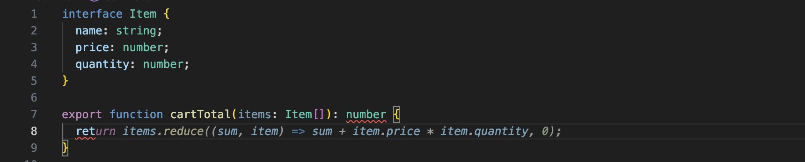

# Local Autocomplete

Inline code completions in VS Code from a model that runs on your own machine — Ollama, LM Studio, `llama-server` (llama.cpp), vLLM, LocalAI. Nothing leaves your computer, and there is no subscription.

The model is chosen by you, and can be switched per file, per language, or everywhere, from the status bar.



## Requirements

1. A local server that can run a completion model: [Ollama](https://ollama.com), LM Studio, llama.cpp's `llama-server`, vLLM, LocalAI, …
2. A code model trained for **fill-in-the-middle** (FIM), preferably a *base* (non-instruct) variant. Chat models are trained to talk, not to continue your code, and give poor completions.

With Ollama:

```sh
ollama pull qwen2.5-coder:1.5b-base
```

Anything from ~1.5B up works; bigger models are better but slower. The default setting is `qwen2.5-coder:1.5b-base`.

## Quick start

Install the extension, start your server, then open the status bar item (bottom right, `✨ Autocomplete`) and pick **Select model…**. That's it — completions appear as ghost text as you type; press `Tab` to accept.

If the server is not on the default port, set `localAutocomplete.provider` and `localAutocomplete.endpoint`:

| Server | provider | endpoint |
| --- | --- | --- |
| Ollama | `ollama` | `http://127.0.0.1:11434` (default) |
| LM Studio | `openai-compatible` | `http://127.0.0.1:1234/v1` (default) |
| llama.cpp `llama-server` | `openai-compatible` | `http://127.0.0.1:8080/v1` |
| vLLM / LocalAI | `openai-compatible` | `http://host:port/v1` |
| Anything else that only answers `/v1/chat/completions` | `openai-chat` | `http://host:port/v1` |

Leave `endpoint` empty to use the provider's default. A bare origin such as `http://127.0.0.1:1234` gets `/v1` added for you.

### Chat-only servers

Some proxies and gateways implement `/v1/chat/completions` and answer `/v1/completions` with
`404: not found`. Pick `openai-chat` for those: the prompt is sent as a single user message, a
markdown fence around the reply is removed, and chain-of-thought in `reasoning_content` is ignored.

This is a compatibility mode, not a quality one — a chat model talks about code instead of
continuing it, so set `fimTemplate` to `custom` and give it an instruction instead of
fill-in-the-middle markers:

```
Complete the code. Return ONLY the missing code, no explanation and no markdown fence.

Code before the cursor:
{prefix}
Code after the cursor:
{suffix}
Missing code:
```

A reasoning model thinks before it answers, so raise `maxTokens` until the reply contains any code
at all; if it spends the whole budget thinking, the extension says so instead of staying quiet.

## Turning it on and off

Three switches, most specific wins:

1. **Everywhere** — `localAutocomplete.enable`. Off means off: no request is made, whatever the other settings say.
2. **Per language** — `localAutocomplete.disabledLanguages`, e.g. `["markdown", "plaintext"]`.
3. **Per file** — remembered in extension storage, keyed by the file's URI. A notebook cell belongs to its notebook. Overrides for files that are deleted or renamed are dropped automatically, and only the 200 most recent files are kept.

The status bar shows which switch decided the current file, and clicking it opens a menu with the three toggles, model selection, the API key, settings and the log. If you would rather not see it, set `localAutocomplete.showStatusBar` to `iconOnly` or `hidden`. The same actions are commands:

| Command | What it does |
| --- | --- |
| `Local Autocomplete: Show Menu` | The status bar menu |
| `Local Autocomplete: Toggle Everywhere` | Flips `localAutocomplete.enable` |
| `Local Autocomplete: Toggle for Current Language` | Adds/removes the language in `disabledLanguages` |
| `Local Autocomplete: Toggle for Current File` | Overrides for this file only |
| `Local Autocomplete: Select Model` | Lists the models on the server and sets `localAutocomplete.model` |
| `Local Autocomplete: Generate Commit Message` | Drafts a commit message from the git diff. Also the sparkle button in the Source Control title bar |
| `Local Autocomplete: Set API Key` | Stores a bearer token in your OS keychain (also clears the deprecated setting) |
| `Local Autocomplete: Forget All Per-File Settings` | Drops every per-file override |
| `Local Autocomplete: Show Log` | Opens the output channel |

Per-language and everywhere state are settings, so they sync across machines and can be set per workspace. Per-file choices are not.

## Commit messages

The Source Control view has a sparkle button in its title bar, **Generate Commit Message**. It sends only the staged diff (`git diff --cached`) to your model and writes the reply into the commit box. Unstaged and untracked files are left out; stage them first. If nothing is staged, the button tells you so and does not ask the model. A notification shows while it runs, and Cancel leaves the box unchanged. Clicking the button again starts over.

The same command is in the status bar menu and the Command Palette. When Git opens `COMMIT_EDITMSG` in an editor (because VS Code is Git's `core.editor`), the button is on that editor's title bar and the message is written there. Set `commitMessage` to `false` to hide the button and the command.

Set `commitMessageModel` to an instruct model. The default completion model is a base fill-in-the-middle model, which continues text instead of following "write a commit message", so it drafts a poor one. The request goes to the chat endpoint (`/api/chat` on Ollama, `/v1/chat/completions` otherwise), on the same server as completions.

## Settings

| Setting | Default | Notes |
| --- | --- | --- |
| `enable` | `true` | Master switch |
| `disabledLanguages` | `[]` | [Language identifiers](https://code.visualstudio.com/docs/languages/identifiers) where completions are off |
| `provider` | `ollama` | `ollama`, `openai-compatible` or `openai-chat` (machine scope) |
| `endpoint` | `""` | Base URL; empty for the provider default (machine scope) |
| `model` | `qwen2.5-coder:1.5b-base` | Name as the server knows it |
| `apiKey` | — | **Deprecated:** the bearer token now lives in your OS keychain — use `Local Autocomplete: Set API Key`. A value already in settings is migrated on startup and the setting is cleared. |
| `fimTemplate` | `auto` | `auto`, `qwen`, `codellama`, `deepseek`, `starcoder`, `codegemma`, `codestral`, `custom` |
| `customFimTemplate` | `<|fim_prefix|>{prefix}<|fim_suffix|>{suffix}<|fim_middle|>` | Used when `fimTemplate` is `custom`; must contain `{prefix}` |
| `stopSequences` | `[]` | Extra sequences that end a completion |
| `multiline` | `auto` | `auto` = multi-line on empty lines and after `{ ( [ :`; `always`; `never` |
| `maxTokens` | `128` | Tokens generated per completion |
| `temperature` | `0.1` | Lower is more predictable |
| `debounceMs` | `200` | Wait after you stop typing before asking the model |
| `maxPrefixChars` | `4000` | Context before the cursor (~3–4 chars per token) |
| `maxSuffixChars` | `1000` | Context after the cursor |
| `stream` | `true` | Read the reply as it arrives, and stop generating once the completion is finished |
| `timeoutMs` | `30000` | How long to wait for the server. With streaming it is the time allowed **between** chunks, so a slow first token still fails but a steady stream does not |
| `maxContextTokens` | `8192` | Largest context window the extension may ask Ollama for (`num_ctx`). `0` never sends it and leaves the server in charge |
| `keepAlive` | `""` | Ollama only: how long to keep the model loaded, e.g. `5m`. Empty uses the server default |
| `commitMessage` | `true` | Show the Generate Commit Message button and command |
| `commitMessageModel` | `""` | Instruct model for commit messages. Empty uses `model` |
| `commitMessageMaxDiffChars` | `20000` | Diff characters sent for a commit message; the rest is cut from the end |
| `showStatusBar` | `always` | `always`, `iconOnly`, or `hidden` |

`multiline`, `maxTokens`, `temperature`, `debounceMs`, `maxPrefixChars` and `maxSuffixChars` are language-overridable, so a `[python]` block in `settings.json` can ask for longer completions in Python than in JSON:

```json
{ "localAutocomplete.maxTokens": 64, "[python]": { "localAutocomplete.maxTokens": 256 } }
```

`fimTemplate: auto` recognises the format from the model name. Each family is trained on its own special tokens, and a mismatch gives poor or empty completions — if the log says the format was guessed, set it explicitly.

## How it behaves

- **Works alongside IntelliSense.** While the suggestion list is open, the completion is written as if the selected item had been accepted, so the ghost text fits the code you are about to have.
- **No completion in the middle of a word** — if characters follow the cursor that look like part of an identifier, you are editing a name, not writing code.
- **Multi-line completions stop** when the model's output drops back to a lower indent or repeats the first non-empty line below the cursor.
- **Single-line completions may overwrite the rest of the line** when it appears in order inside the completion, which avoids duplicated auto-closed brackets and quotes.
- **Recent completions are cached** (64 entries) keyed by the text around the cursor: typing the start of a suggestion, or deleting back to where it was made, is answered without asking the model again.
- **The prompt is cut at whole lines** so its start stays put while you type, which lets the server reuse its prompt cache.
- **Completions stream** (`localAutocomplete.stream`). The first characters appear as soon as the server sends them, and the request is closed the moment the completion cannot change any more — a stop sequence landed, or the block clearly ended. Turn it off to get one response back, which is what a server that does not support streaming needs.
- **The context window is requested, not assumed.** Ollama defaults to 4096 tokens and silently drops the *start* of a longer prompt, which cuts off the `<|fim_prefix|>` marker and produces nonsense. When the prompt needs more, the extension asks for a bigger `num_ctx` (up to `maxContextTokens`) and logs what it did. If a server still refuses, the notification tells you to shrink `maxPrefixChars`.
- **Requests are cancelled as soon as you keep typing,** and give up after `timeoutMs`. The first failure of each kind raises one notification (with *Copy Command* for a missing Ollama model, *Open Settings*, *Show Log*); later ones only mark the status bar and the log, so a stopped server does not pop up on every keystroke.
- Completions are offered in normal editors, notebook cells, remote and virtual workspaces — not in output panes, diff views or the commit message box. Untrusted workspaces are supported; nothing is sent anywhere but to the server you configured.

## Development

```sh
npm install
npm run compile          # tsc -> out/
npm run watch
npm test                 # unit tests (node --test)
npm run test:integration # real VS Code via vscode-test
npm run format           # prettier --write
npm run format:check     # prettier --check, run by CI
npm run package          # -> local-autocomplete-<version>.vsix
```

The integration test starts a stub Ollama server in-process (`/api/generate` and `/api/tags`), so it needs no local model. To run it against your installed VS Code instead of downloading one:

```sh
VSCODE_EXECUTABLE="/Applications/Visual Studio Code.app/Contents/Code" npm run test:integration
```

`.vscode/` is committed with a launch config: press `F5` to start an Extension Development Host that runs the extension from `out/`.

GitHub Actions runs the format check, the compile and the unit tests on Linux, macOS and Windows, and the integration tests under Xvfb (`.github/workflows/ci.yml`). Pushing a `v*` tag builds the `.vsix` and attaches it to the release.

## License

[MIT](LICENSE).
